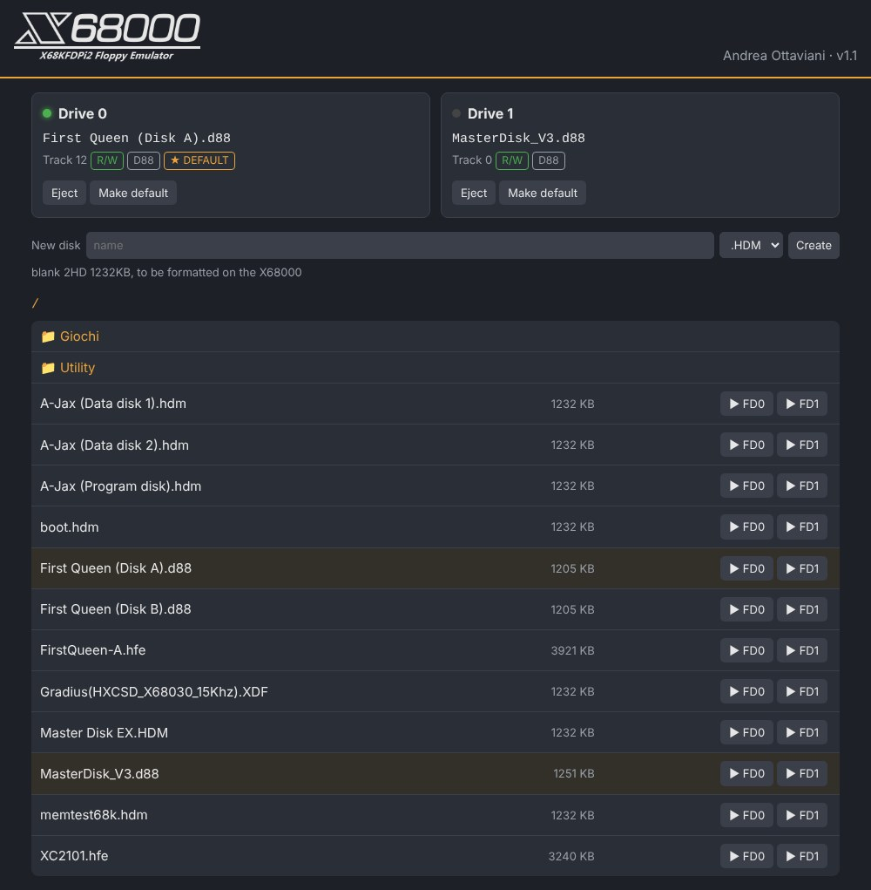
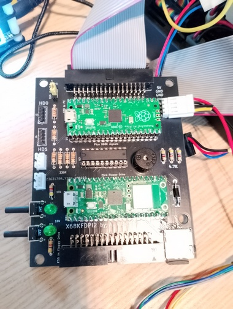
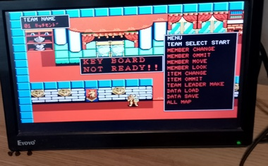
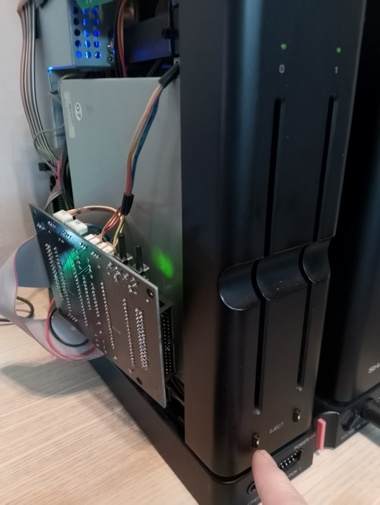
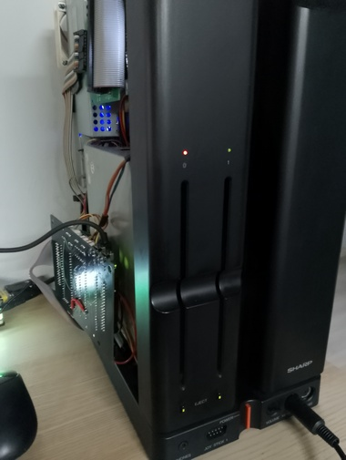

# X68KFDPi2W
X68KFDPi2W - Floppies drive emulator All-In-One for Sharp X68000

The design is an evolution of my previous X68KFDPico, and allows the two drives of the X68000 to be emulated both externally and internally connected. The engine of the emulator are two Raspberry Pico, one ‘normal’ to handle the special floppy signals and the other ‘W’ to emulate the floppies, SDcard image management and a simple web server to choose the disks to be inserted in the floppies.
Ejection and insertion of the disks can be done via the two keys in the X68KFDPi2W or by connecting the cables of the original floppy keys (in case they are not present internally). The same for the internal LEDs, which are however replicated in the emulator (only the green one, the red LED is managed only for the internal one).
Floppies images format supported:

| Format | Extension | Read | Write | Notes |
|---|---|---|---|---|
| Raw sector image | `.HDM`, `.XDF` | yes | yes | X68000 2HD 1232KB (77x2x8x1024); 2HC 1.2MB (80x2x15x512) also recognised by size |
| D88 | `.D88`, `.D68`, `.88D` | yes | yes | 2HD media, any sector layout (sector sizes, numbering, deleted data). The write protect flag of the image is honoured |
| DIM (DIFC.X) | `.DIM` | yes | yes | 2HD, 2HS, 2HC, 2HDE, 26x256. 2HQ (1.44MB) is not supported (needs a 300rpm drive) |
| HFE | `.HFE` | yes | no | the drive reports write protect |

Writing to floppy images is supported: the X68000 can copy files, format disks (FORMAT) and save games to the images on the SD card.
2D/2DD (double density) images and FM sectors are not supported.

### How writing works

- WRDATA is captured by a PIO state machine that measures the time between flux transitions, and a DMA channel stores them in RAM, so no write is missed while the Pico is busy (WiFi, web server).
- Core 1, which generates the read flux, watches WRGATE and records drive, side, track and the position on the track where each write starts. A normal sector write has no ID field, so the sector is found from that position; when formatting, the ID fields written by the X68000 are used.
- Core 0 decodes the MFM data with the routines of the Adafruit Floppy library (`mfm_impl.h`), checks the CRC, updates the track in memory (a verify read returns the new data immediately) and saves the sectors to the SD card when the write session ends (step, side or drive change, or 100ms without writes).
- Track format: a whole track is longer than the capture buffer, so the sectors not captured are filled with the same fill byte used by the X68000 (log line `format: 5 sectors decoded, 3 filled with E5`).
- The serial log shows one `WR:` line per write and per save.

### Web interface

- Live status of the two drives (activity/write LED, track, R/W or read only, image format), updated every second.
- One click insert in drive 0 or 1 for every image in the folder; folders are listed first.
- "Make default" stores the full path of the image in `wifi.cfg`; on an empty drive it makes the drive start empty at power on (★ DEFAULT tag).
- "New disk": creates a blank, unformatted 2HD 1232KB image (`.HDM` or `.D88`) in the current folder; insert it and format it on the X68000 with FORMAT.

### Options (top of X68KFDPi2W.ino)

- `DEBUG_BUS` (default 0): 1 prints MOTOR / DRIVE SELECT changes on the serial port (verbose).
- `RESET_ON_DESELECT` (default 1): the head goes back to track 0 when the drive is deselected or the motor stops. Needed by games that ask to swap disks (e.g. A-JAX).

### Building the firmware

- Arduino IDE with the Raspberry Pi Pico core by Earle Philhower (tested with 6.3.x), board "Raspberry Pi Pico W".
- Libraries: Adafruit Floppy (and its dependency Adafruit BusIO); SdFat is the one included with the core.
- `drive.pio.h` is generated from `drive.pio` with `pioasm drive.pio drive.pio.h` (the Arduino IDE does not do it).
- `logo.h` contains the web page logo (from `vari/logo.png`).

A special thanks to Adafruit team for their great "Floppy library", from wich i starded for floppy emulation part.

**NOTE** Last revision fix a conflicts found when using both an internal and an external X68KFDPi2W for 4 floppy emulation, now disabled 74LVC245 when drives not enabled. 
Please use last PCB, X68KFDPico.u2f and X68KFDPi2W.u2f version!!

**NOTE 2** Some games need tricks to properly boot, for example A-JAX works when starting with both drive off (leds off). When using 2HDboot.x for launching games from HD, you must "insert" floppy 1 & 2 pushing buttons when 2hdboot starts, then "eject" pushing again button after few seconds.

You need to add a "wifi.cfg" in root of your SDcard, with this 4 text row:
SSID
WIFI PASSWORD
Default floppy in drive 0
Default floppy in drive 1

The 2 lines related to the default floppys can be omitted and changed everytime via Web server (a full path, e.g. `/games/boot.hdm`, or an empty line for an empty drive).

Gerbers file are provided for the PCB, add you pico clone, and flash the firmware ".uf2" in the Pico and in the Pico W by connecting it while pressing button on Pico and drop it in the opened windows on PC.

For any comments or questions about the projects, please use the official thread in the forum: https://nfggames.com/forum2/index.php?topic=7512.0

